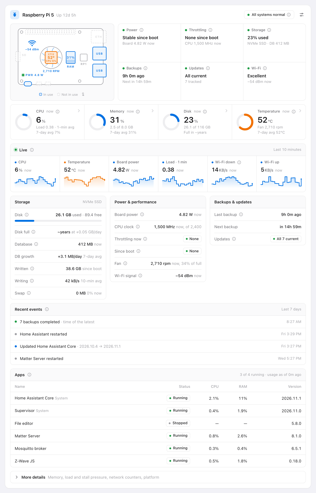

# Pi Vitals card

A Raspberry Pi health dashboard for Home Assistant, in a single card. It's built to answer what Pi owners actually ask: *is it throttling, is the power supply OK, is my SD card OK, are backups running?*



*Screenshot uses simulated data. There is a [dark version](images/pi-vitals-dark.png) too.*

- **A live board drawing.** Parts in use are drawn in color with their live reading (processor temperature and load, RAM, SD card, board watts, Wi-Fi signal, fan speed); empty or unused ports are faded. USB counts as in use when something is plugged in. Hover a part for a one-line summary, or tap it for its live readings (each opens its history) and specs for your board.
- **A verdict with its reasons.** "All systems normal" (or the worst problem), plus status facts beside the board: power, throttling, storage, backups, updates, Wi-Fi.
- **Ring gauges** for CPU, memory, disk and temperature, each compared with its own 7-day normal ("Usually 4%", or "Above usual" when it's well outside its normal swing). Disk shows when it would be full at its typical daily growth. Tap one for its history.
- **Live sparklines** covering the last 10 minutes. Hover (or drag on a phone) and the big number shows that moment, with its time; click one for its longer history (so do Apps rows).
- **Every number says what it is:** `now` for the latest reading, or its window (`1-min avg`, `7-day avg`, `since boot`).
- **Storage wear.** Disk use, a disk-full forecast, database size and daily growth, data written since boot, and the write rate now.
- **Power & performance.** Throttle flags (now and since boot), measured CPU clock, fan speed, Wi-Fi signal.
- **Backups, updates and apps.** Only pending updates are listed, plus each app's CPU and RAM. The Backups and Updates facts open those Settings pages.
- **Recent events** from the last 7 days: Pi reboots, Home Assistant restarts, throttling and power dips, failed backups (successful ones collapse into one row), apps stopping or restarting, and installed updates.
- **More details** (collapsed): RAM and swap, load average, stall pressure, network counters, platform versions.
- **Two styles.** *Studio*, the card's own calm look (light and dark follow Home Assistant), or *My theme*, which takes every color from your dashboard theme.
- **Settings** (the sliders button in the header): style, °F or °C, show or hide the ⓘ explanations, show or hide the Apps table. Saved to each person's Home Assistant profile, so they follow you to every device.

Every number has an ⓘ tooltip in plain English. Sensors are found by what they are, not by entity ID, so it works on installs in any language. If System Monitor is missing or some of its sensors are off, the card says which ones and links to the page where you turn them on. The layout adapts to the card's width, from phone to widescreen. Light and dark mode follow your theme. No dependencies, no build step, one file.

## Install

Needs Home Assistant 2025.1 or newer (tested on 2026.11).

**Marketplace (Home Assistant 2026.11+):** Settings → Marketplace → **Add from link** → `samansabeti/pi-vitals-card` → install **Pi Vitals**. The Marketplace adds the dashboard resource for you.

**HACS (Home Assistant before 2026.11):** HACS → ⋮ → Custom repositories → add `https://github.com/samansabeti/pi-vitals-card` as type *Dashboard* → install **Pi Vitals** → reload the browser.

**Manual:** copy `pi-vitals-card.js` to `/config/www/`, then add it under Settings → Dashboards → ⋮ → Resources as `/local/pi-vitals-card.js?v=1` (JavaScript module). Bump `v` after updating the file.

Then add the card. It also shows up in the card picker when you start from a System Monitor or Raspberry Pi sensor:

```yaml
type: custom:pi-vitals-card
```

## What it needs

| Data | Source | Required? |
|---|---|---|
| CPU, memory, disk, temperature, load, network, swap, stall pressure, uptime, IP | **System Monitor** integration (Settings → Devices & services → Add → System Monitor). Enable the sensors you want: they're disabled by default. | Yes. The card hides anything missing and tells you which sensors to turn on |
| Under-voltage | **Raspberry Pi Power Supply Checker** integration | Optional |
| Backups, updates, apps | Built into Home Assistant OS (Backup, Supervisor and update entities) | Optional |
| Board power, throttle flags, CPU clock, Wi-Fi signal, SD writes, database growth | `extras/pi_vitals.py` (below) | Optional |

### Optional: the Pi vitals sensor (HA OS on Pi 4/5)

System Monitor can't see the Pi's firmware. `extras/pi_vitals.py` reads it directly through `/dev/vcio`, which works inside the Home Assistant container without `vcgencmd`. It prints one JSON line. Board power needs a Pi 5; the other parts work on a Pi 4 too, and any part that isn't available is simply left out.

1. Copy `extras/pi_vitals.py` to `/config/pi_power/pi_vitals.py`, using the Studio Code Server or Samba app.
2. Add this to `configuration.yaml`, then run **Check configuration** and reload **Command line entities** (Developer tools → YAML):

```yaml
command_line:
  - sensor:
      name: Pi board power
      unique_id: pi_board_power
      command: "python3 /config/pi_power/pi_vitals.py"
      value_template: "{{ value_json.watts }}"
      json_attributes: [rails, model, throttled, arm_mhz, wifi_dbm, wifi_iface, disk_device, disk_written_gb, disk_write_kbs, db_mb, db_mb_per_day, throttle_events]
      unit_of_measurement: W
      device_class: power
      state_class: measurement
      scan_interval: 30
```

Board power is the sum of the PMIC's own rails. It leaves out USB devices and supply losses, so it reads a little under what a wall meter shows. Database growth appears after the sensor has run for a day.

## Options

All optional. Set them in the visual editor (Edit dashboard → the card), grouped as Thresholds, Sensors and Notes, or in YAML:

| Option | Default | |
|---|---|---|
| `style` | `studio` | `studio` (the card's own look) or `theme` (your dashboard theme's colors). Each viewer can still switch in Settings |
| `title` | auto (board model from Home Assistant's hardware info, else "Raspberry Pi"; "Home Assistant host" off a Pi, where the board drawing is hidden) | Model label |
| `prefix` | — | Only if sensors are found wrongly: forces the old lookup by English entity IDs with this prefix (e.g. `sensor.system_monitor_`) |
| `interface` | auto (`wlan0`, `eth0`, `end0`) | Network interface to show |
| `vitals_entity` | `sensor.pi_board_power`, else auto-detected | The pi_vitals sensor |
| `power_status_entity` | auto (Raspberry Pi Power Supply Checker) | Under-voltage sensor |
| `cores` | `4` | Used for load % |
| `fan_max_rpm` | `8000` | Fan % scale (Pi 5 Active Cooler) |
| `temp_warn_c` / `temp_bad_c` | `65` / `80` | Temperature thresholds in °C, whatever unit the card shows |
| `backup_stale_days` | `3` | Warn when the last backup is older than this |
| `backup_note` | — | Extra sentence for the backup tooltip ("Also copied to my NAS") |
| `footer` | — | Small note at the bottom of More details |
| `temperature_unit` | your HA unit system | `F` or `C`. Each viewer can still change it in Settings |
| `show_apps` | `true` | Show the Apps table (each viewer can change it in Settings) |

### Colors

Pick *Studio* or *My theme* in the card's Settings (or `style:` in YAML). To give the data a different hue, set `--pv-accent`. You can set it in your theme or with card-mod:

```yaml
pv-accent: "#14B8A6"
```

In *My theme*, status colors come from your theme's `--success-color`, `--warning-color` and `--error-color`.

## Tested

On a Pi 5 (8 GB, HA OS, Wi-Fi, SD card) running Home Assistant 2026.11. The card was also rendered against simulated installs: German entity IDs, a Pi 4 on Ethernet with °C sensors and no vitals sensor, a non-Pi host with only two System Monitor sensors, and no System Monitor at all. Please open an issue with a screenshot if something looks off on your setup.

## License

MIT
